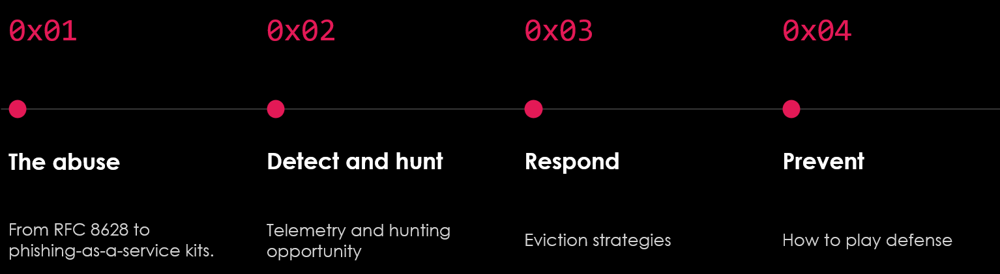
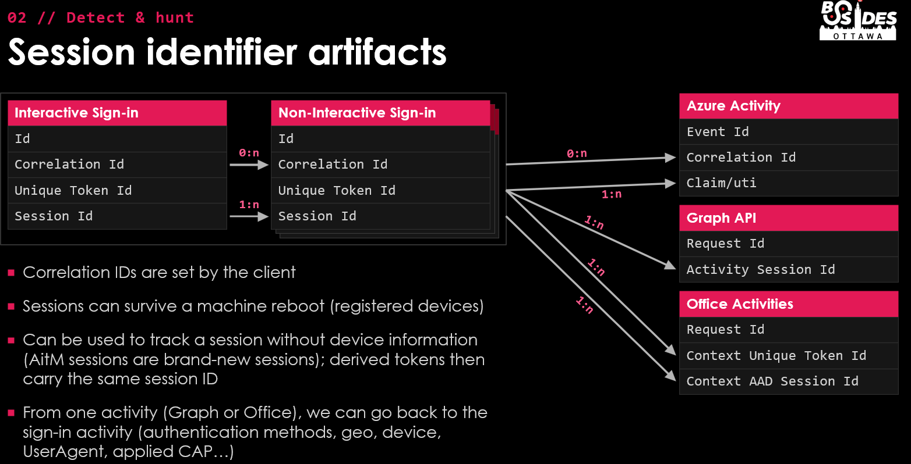

# Phishing-Resistant… Until You Enter This Code.

📅 Thu, Nov 19, 2026, 10:15 - 10:45 (EST)
🌍 Ottawa, ON - Canada

Device Code Flow helps users authenticate on devices with limited input capabilities, but attackers have learned to abuse it by getting users to authenticate on their behalf. In this session, we'll demonstrate a real-world attack scenario, explore what it looks like from a defender's perspective, and discuss practical ways to detect and mitigate Device Code Flow abuse in Entra. You'll leave with actionable guidance to better protect your organization against this increasingly common technique.



🗃️ [Download the slide deck](media/deck.pdf)

## 0x01 The abuse

📹 Demo 1 - [Old school Device Code Flow abuse](media/demo1.mp4)
📹 Demo 2 - [Dynamic Device Code Flow abuse](media/demo2.mp4)


## 0x02 Detect and Hunt



#### Find device code sign-ins:
```kql
SigninLogs
| where TimeGenerated > ago(14d)
| where AuthenticationProtocol == "deviceCode"
```

#### Find sessions where device code was involved:
```kql
SigninLogs
| where TimeGenerated > ago(14d)
| where AuthenticationProtocol == "deviceCode"
| summarize arg_max(CreatedDateTime, *) by Id
| join kind=leftouter (
     AADNonInteractiveUserSignInLogs 
) on SessionId
```

#### Find sign-in activities post device code:
```kql
union SigninLogs, AADNonInteractiveUserSignInLogs
| where TimeGenerated > ago(14d)
| where OriginalTransferMethod == "deviceCodeFlow"
| summarize arg_max(CreatedDateTime, *) by Id
```

#### Track post actions in the Graph API:
```kql
union SigninLogs, AADNonInteractiveUserSignInLogs
| where TimeGenerated > ago(14d)
| where OriginalTransferMethod == "deviceCodeFlow"
| where ResourceDisplayName == "Microsoft Graph"
| summarize arg_max(CreatedDateTime, *) by Id
| project CreatedDateTime, UserPrincipalName, UniqueTokenIdentifier
| join (
    MicrosoftGraphActivityLogs
    | project TimeGenerated, RequestMethod, RequestUri, ResponseStatusCode, SignInActivityId
) on $left.UniqueTokenIdentifier == $right.SignInActivityId
```

#### Track post actions in the Microsoft 365 (Exchange, Teams, OneDrive, SharePoint):
```kql
union SigninLogs, AADNonInteractiveUserSignInLogs
| where TimeGenerated > ago(14d)
| where OriginalTransferMethod == "deviceCodeFlow"
| summarize arg_max(CreatedDateTime, *) by Id
| project CreatedDateTime, UserPrincipalName, ResourceDisplayName, UniqueTokenIdentifier
| join (
    OfficeActivity
    | extend UTI = tostring(AppAccessContext.UniqueTokenId)
    | project TimeGenerated, UTI, OfficeWorkload, OfficeObjectId, RecordType
) on $left.UniqueTokenIdentifier == $right.UTI
```

#### Check for non compatible Continuous Access Evaluation after Device Code for a given SessionId:
union SigninLogs, AADNonInteractiveUserSignInLogs
| where TimeGenerated > ago(90d)
| where OriginalTransferMethod == "deviceCodeFlow"
| where SessionId == "004d167a-7f07-a497-25b4-34215bdfd62f"
| mv-apply CAECheck = todynamic(AuthenticationProcessingDetails) on (
    extend CAE = iif(CAECheck.key == "Is CAE Token" and CAECheck.value == "False", False, True)
)
| summarize arg_max(CreatedDateTime,CreatedDateTime, UserPrincipalName, SessionId, ResultType, AppDisplayName, ResourceDisplayName, CAE) by UniqueTokenIdentifier
| where CAE == false
```

#### Check for unusual sign-in locations (in general):
```kql
let CompromisedSessionId = pack_array("ecb707e9-67ab-4a45-8894-d3a528336d64","ea5bd3fe-736d-4f4f-b803-2ccafd175f8e");
let LookBackStart = ago(90d);
let LookBackEnd = ago(1d);
let ZoomLevel = 6; //6:150km 5:315km
SigninLogs
| where TimeGenerated > LookBackEnd
| where ResultType == 0
| extend Latitude = toreal(LocationDetails.geoCoordinates.latitude)
| extend Longitude = toreal(LocationDetails.geoCoordinates.longitude)
| extend GeoHash = geo_point_to_s2cell(Longitude, Latitude, ZoomLevel)
| extend LocationText = strcat(LocationDetails.city, ", ",LocationDetails.state, ", ", LocationDetails.countryOrRegion)
| summarize Places = make_set(LocationText) by UserPrincipalName, GeoHash
| join kind=leftanti (
    SigninLogs
    | where TimeGenerated between (LookBackStart .. LookBackEnd)
    | where SessionId !in (CompromisedSessionId)
    | where ResultType == 0
    | extend Latitude = toreal(LocationDetails.geoCoordinates.latitude)
    | extend Longitude = toreal(LocationDetails.geoCoordinates.longitude)
    | extend GeoHash = geo_point_to_s2cell(Longitude, Latitude,ZoomLevel)
    | extend GeoArea = array_concat(geo_s2cell_neighbors(GeoHash), pack_array(GeoHash))
    | mv-expand GeoArea to typeof(string) 
) on UserPrincipalName, $left.GeoHash == $right.GeoArea
```

#### Unsual "token travel" obtained through a Device Code flow: 
```kql
AADNonInteractiveUserSignInLogs
| where TimeGenerated > ago(90d)
| where ResultType == 0
| where OriginalTransferMethod == "deviceCodeFlow"
| extend Latitude = toreal(todynamic(LocationDetails).geoCoordinates.latitude)
| extend Longitude = toreal(todynamic(LocationDetails).geoCoordinates.longitude)
| project CreatedDateTime, Longitude, Latitude, SessionId
| partition hint.strategy=native by SessionId (
    order by CreatedDateTime asc 
    | extend Distance = geo_distance_2points(Longitude, Latitude, prev(Longitude), prev(Latitude))
    | extend Track = row_cumsum(Distance) //could be reset if time difference is too large
    | project CreatedDateTime, SessionId, Distance, Track
)
| where Track > 0
| summarize max(Track), min(CreatedDateTime), max(CreatedDateTime) by SessionId
| lookup (
    AADNonInteractiveUserSignInLogs 
    | where TimeGenerated > ago(90d)
    | where OriginalTransferMethod == "deviceCodeFlow"
    | summarize Locations = make_list(Location) by SessionId
) on SessionId
```

#### User-Agent switch within a session started with DeviceCode:
```kql
AADNonInteractiveUserSignInLogs
| where TimeGenerated > ago(14d)
| where ResultType == 0
| where OriginalTransferMethod == "deviceCodeFlow"
| where SessionId == "004d167a-7f07-a497-25b4-34215bdfd62f"
| where isempty(todynamic(DeviceDetail).deviceId)
| summarize UserAgents = make_set(UserAgent) by SessionId, AppDisplayName, ResourceDisplayName
| where array_length(UserAgents) > 1
```

## 0x03 Respond

#### Check for unusual sign-in locations for a given sign-in ID using device code:
```kql

```

#### Look for new authentication methods, joined device and Exchange rules after a device code:
```kql

```

## 0x04 Prevent

References:

🔗 Inside an AI‑enabled device code phishing campaign https://www.microsoft.com/en-us/security/blog/2026/04/06/ai-enabled-device-code-phishing-campaign-april-2026/

🔗 Unmasking EvilTokens: Getting to the root of device code phishing https://www.microsoft.com/en-us/security/blog/2026/09/22/unmasking-eviltokens-getting-to-the-root-of-device-code-phishing/

🔗 Disrupting EvilTokens: The AI Chatbot Built for Cybercrime https://blogs.microsoft.com/on-the-issues/2026/09/22/disrupting-eviltokens-the-ai-chatbot-built-for-cybercrime/


## What's new around Device Code flow abuse in the era of Agentic AI?

🔗 The risks of device code authentication for AI coding agents https://www.microsoft.com/en-us/security/blog/2026/11/17/the-risks-of-device-code-authentication-for-ai-coding-agents/

